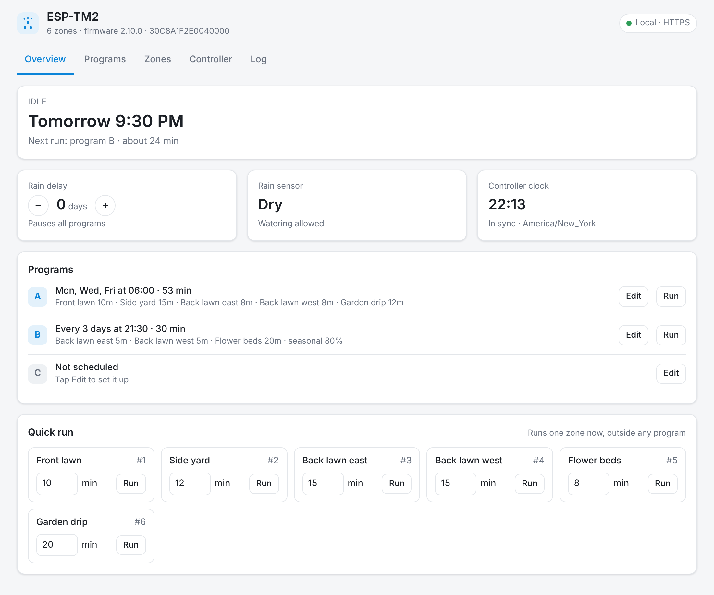
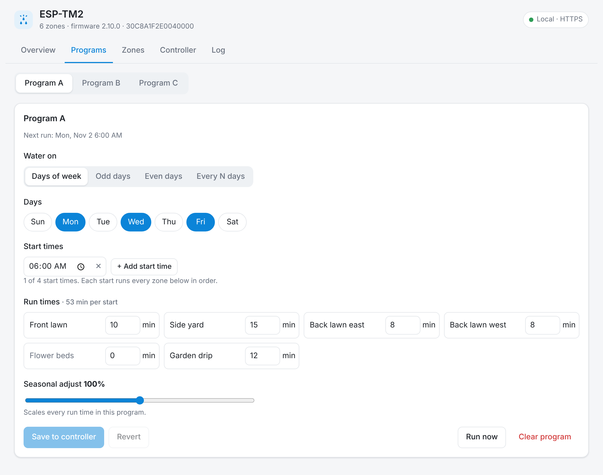
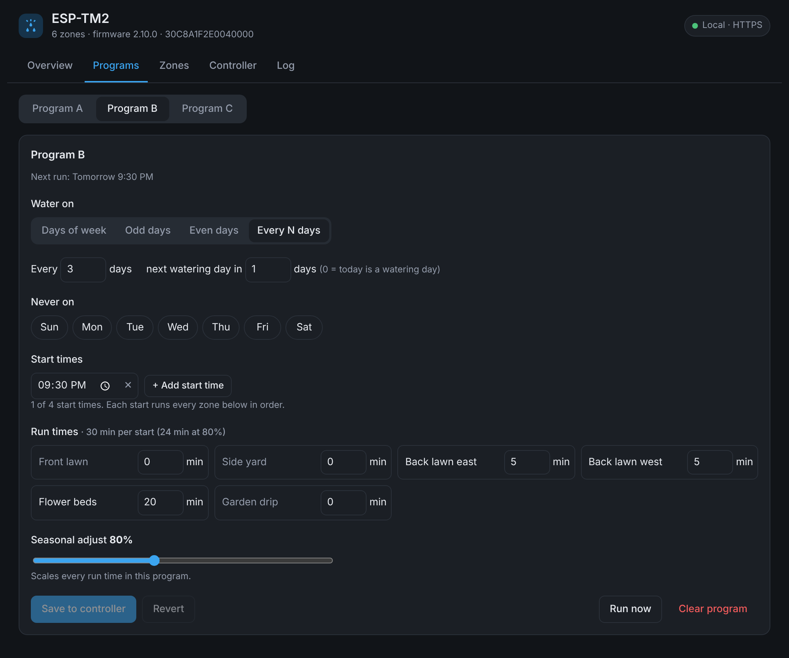
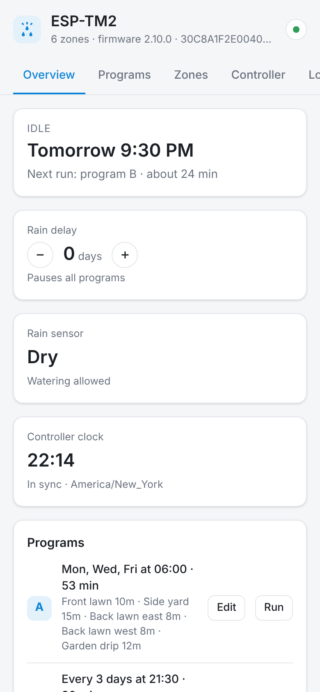
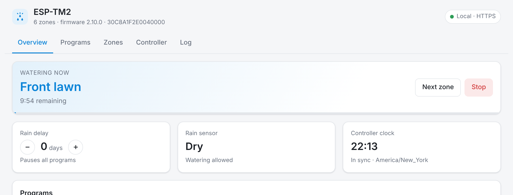

# Rain Bird ESP-TM2 for Home Assistant (local)

**Full local control of Rain Bird ESP-TM2 sprinkler controllers - no Rain Bird cloud, no phone app, no waiting.**
A Home Assistant app with its own sidebar page (like Zigbee2MQTT) that lets you edit your watering
programs, and MQTT entities for your dashboards and automations.

[](https://my.home-assistant.io/redirect/supervisor_add_addon_repository/?repository_url=https%3A%2F%2Fgithub.com%2Fabmina%2Frainbird-tm2-addon)

[](https://github.com/abmina/rainbird-tm2-addon/releases)
[](https://github.com/abmina/rainbird-tm2-addon/actions/workflows/test.yaml)

[](LICENSE)



## Why

The Rain Bird phone app sends every tap through Rain Bird's servers, and it is slow. The built-in Home Assistant
integration is local, but it can only run zones and set a rain delay - you can't see or change your
programs. This Home Assistant app talks directly to the controller's WiFi module on your network and does both.

## Features

- **Program editor** - for programs A, B and C: water on days of the week, odd days, even days or every
  N days; days off; up to 4 start times; run time per zone; seasonal adjust.
- **Safe writes** - every change is written one page at a time, read back from the controller and checked;
  if anything doesn't match, it is rolled back.
- **Live status** - what is watering, time remaining, next scheduled run, rain sensor, rain delay.
- **Quick runs** - run any zone for any number of minutes, stop, skip to the next zone.
- **Home Assistant entities over MQTT** - a switch per zone, program buttons, rain delay, seasonal adjust,
  rain sensor, next run and more, all on one device.
- **Keeps the controller clock right** - including daylight saving time changes (the ESP-TM2 has no DST).
- **Finds your controller** - a setup screen scans your network for Rain Bird WiFi modules.
- **Locked down** - security rating 8/8: runs isolated with an AppArmor profile, web page only through
  Home Assistant's login. Never contacts the internet.

| Program editor | Dark mode | Phone |
|---|---|---|
|  |  |  |

## Supported devices

| Controller | Model ID | Status |
|---|---|---|
| **ESP-TM2** | `010A` (firmware 2.10) | ✅ Tested daily |
| ESP-TM2 (older) | `0005`, `000A` | 🟡 Same protocol - should work |
| ESP-Me / ESP-ME3 / ESP-Me2 | `0007`, `0009`, `0010` | 🟡 Same protocol (4 programs) - not yet tested |
| TM2R / TRU | `0014`, `0015` | 🟡 Same protocol - not yet tested |
| ESP-RZXe, ST8x-WiFi | `0003`, `0006`, `0008` | ❌ Different (per-zone) scheduling - not supported yet |

Needs the Rain Bird **LNK, LNK2 or LNK3** WiFi module plugged into the controller, and Home Assistant
**OS or Supervised** (anything with the Apps page).

**Have a 🟡 controller?** Please [report how it went](https://github.com/abmina/rainbird-tm2-addon/issues/new?template=device_report.yml) -
even "it works" helps others.

## Install

1. Click **Add repository to Home Assistant** above, or go to *Settings → Apps → Install app → ⋮ (top right) → Repositories → Add* and enter `https://github.com/abmina/rainbird-tm2-addon`.
2. Install **Rain Bird ESP-TM2**, start it, and turn on *Show in sidebar*.

   > On older Home Assistant versions, apps are called **add-ons**: *Settings → Add-ons → Add-on store →
   > ⋮ → Repositories*.
3. Open **Rain Bird** in the sidebar, click **Scan network**, pick your controller and enter its
   **device password** - the controller password set in the Rain Bird phone app (not your WiFi or Rain Bird
   account password).

For Home Assistant entities, install the **Mosquitto broker** app and the **MQTT** integration; the
app finds them automatically.

### Recommended

- **Block the WiFi module's internet access** on your router (keep LAN access). The app never needs it,
  and the module is faster and more reliable without its cloud syncing.
- **Don't migrate to the "Rain Bird 2.0" app/firmware** if it is offered - it moves the controller to a
  cloud platform and local access stops working.

Full documentation is on the app's **Documentation** tab ([DOCS.md](rainbird_tm2/DOCS.md)).

## Home Assistant entities



| Entity | |
|---|---|
| `switch` per zone | on = run for that zone's default time, off = stop |
| `number` zone run time | default minutes per zone |
| `button` start program A/B/C, stop, next zone, sync clock | |
| `number` rain delay (0-14 days), seasonal adjust per program | |
| `switch` rain sensor bypass | |
| `sensor` active zone, remaining time, next scheduled run, program A/B/C (schedule in attributes) | |
| `binary_sensor` watering, rain sensor, controller connected | |

Automations can also publish JSON, e.g. water the flower beds for 8 minutes:

```yaml
action: mqtt.publish
data:
  topic: rainbird_tm2/<serial>/cmd/json
  payload: '{"action": "run_zone", "zone": 5, "minutes": 8}'
```

## FAQ

**Does it replace the Rain Bird phone app?** For everything at home, yes. The phone app keeps working on your home
WiFi (the module allows one connection at a time, so avoid using both at the same moment).

**Can I use it with the built-in Rain Bird integration?** Yes, but both poll the same module - removing the
built-in integration avoids slow responses.

**Is my schedule stored in the app?** No. Programs live on the controller; the app only reads and writes
them. If Home Assistant is down, the controller keeps watering on schedule.

**Something isn't working.** Open an [issue](https://github.com/abmina/rainbird-tm2-addon/issues/new/choose)
with the app log and the *Controller → Scan supported commands* output.

## Development

Node.js, no npm dependencies. A simulated ESP-TM2 is included:

```sh
cd rainbird_tm2/app
npm test                     # protocol, end-to-end and setup tests
node test/mock-tm2.js 8443   # simulated controller, password "secret"
DATA_DIR=/tmp/rb RAINBIRD_HOST=127.0.0.1 RAINBIRD_PORT=8443 RAINBIRD_PASSWORD=secret HTTP_PORT=8099 \
  node src/main.js           # then open http://localhost:8099
```

## Credits

The local protocol was reverse-engineered by the community: [pyrainbird](https://github.com/allenporter/pyrainbird)
and the [Hubitat Rain Bird LNK driver](https://github.com/MHedish/Hubitat), which first verified schedule
writes on the ESP-TM2.

---

Not affiliated with or endorsed by Rain Bird Corporation. "Rain Bird" is a trademark of Rain Bird Corporation.
Use at your own risk - this talks to your irrigation controller using a reverse-engineered protocol.
